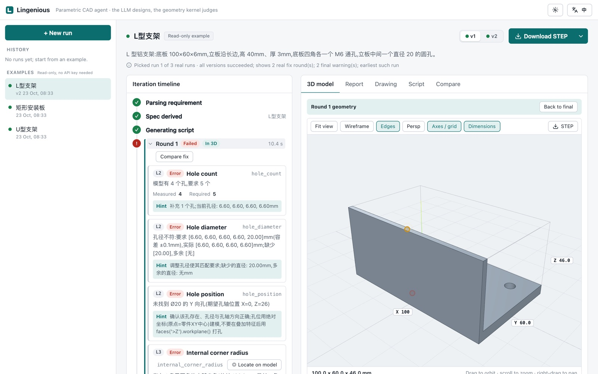

# Lingenious (零件匠)

**English** | [简体中文](README.zh-CN.md)

[](https://github.com/heiworks/lingenious/actions/workflows/tests.yml)

Lingenious is a parametric CAD agent for CNC machining. You describe a part in text; an LLM writes a CadQuery script; the **B-Rep geometry of OpenCASCADE (OCCT) judges the result**: is the solid valid, does it match the requirement, does it follow manufacturability (DFM) rules. If a check fails, the specific violations (with numbers and suggestions) are fed back to the LLM for repair, up to 4 rounds. The output is a STEP file, the parametric script, a render, a three-view engineering drawing and an iteration log.

> Design principle: the LLM designs, the geometry kernel judges. Judgement is deterministic code, so results are reproducible and can be evaluated.

Status: v0.1, early. MIT licensed. Tests run in Docker (see below).



*Web app, L-bracket example, round 1: the missing Ø20 hole and the sharp internal corner are found by geometry checks and marked on the model. Issue texts come from the agent in Chinese.*

## How it works

```
requirement text → spec parsing (LLM, JSON + pydantic) → CadQuery script generation (LLM)
  → sandboxed execution → L1 valid geometry / L2 matches requirement / L3 DFM rules (deterministic code)
  → on error: violations (with values and hints) go back to the LLM, max 4 rounds
  → pass: STEP + part.py + render.png + 3-view drawing (DXF/PDF/PNG) + run.json + log.txt
  → follow-up edit ("make the wall 4mm") → update the spec, modify the previous script, re-check
```

Real iteration log (text is Chinese in the tool's output):

```
Round 1: failed [hole_count] model has 4 holes, 5 required [hole_diameter] ... missing [20.00] [hole_position] no Ø20 hole along Y (expected X=0, Z=26) [internal_corner_radius] 1 sharp internal corner (100.0mm total ...), fillet radius 0mm, required >= 0.5mm (suggest >= 3mm)
Round 2: failed [hole_count] model has 4 holes, 5 required [hole_diameter] ... [hole_position] ...
Round 3: passed
```

### Checks

| Level | Rules |
|---|---|
| L0 | Script syntax / execution errors |
| L1 | Valid solid, single solid, positive volume |
| L2 | Bounding box, hole count, hole diameter, hole position (relative to the part's bounding box, so translation is irrelevant), volume range, holes breaking through the plate edge |
| L3 | Hole-to-edge distance (capped for large holes), sharp internal corners / too-small fillets, minimum wall thickness (approximate), hole spacing, hole depth/diameter ratio, deep pockets, thin-rib height/thickness |

Rules and thresholds: [docs/dfm-rules.md](docs/dfm-rules.md) and `config.yaml`; a review checklist for process engineers: [docs/dfm-review-checklist.md](docs/dfm-review-checklist.md). **Thresholds are generic rules of thumb, not verified by a process engineer**; they are configurable per material and per process.

The L2 assertions are derived by the LLM from the requirement and can be wrong (in the evaluation, `m2` got the Y extent of a U-bracket as 58 instead of 50). So during repair the LLM also sees the original requirement and may dispute an L2 assertion with `# ASSERTION_DISPUTE: <rule>`; a disputed violation is downgraded to a warning and marked "script dispute" in the log. L1 and L3 cannot be disputed. This avoids breaking dimensions to satisfy a wrong assertion; the cost is that the dispute itself relies on the LLM, hence it is logged.

### Outputs

Per version (`out/<name>/v1/`, `v2/` ...): `part.step`, `part.py` (parametric script), `render.png`, `drawing.dxf` / `drawing.pdf` / `drawing.png`, `run.json`, `log.txt`.

The drawing (`core/drawing`) uses OCCT HLR for a third-angle, A3 three-view sheet: visible solid / hidden dashed edges, overall size (exact bounding box), hole diameters and positions taken from the B-Rep (not invented by the LLM), a hole table, title block, and an A-A section for parts with counterbores or blind holes. Not done: tapered counterbores, pocket sections, sections of holes along Y, dedicated views for angled holes (they only appear in the hole table with a note); no tolerances. If HLR fails, all edges are drawn as visible.

## Quick start

Needs only Docker.

```bash
git clone https://github.com/heiworks/lingenious && cd lingenious
cp .env.example .env     # fill in DEEPSEEK_API_KEY
scripts/run.sh bracket "L 型铝支架:底板 100×60×6mm,立板沿长边,高 40mm、厚 3mm,底板四角各一个 M6 通孔,立板中间一个直径 20 的圆孔。" \
    --material 6061 --modify "立板厚度改成 4mm"
```

This builds the image `lingenious:dev`, runs the CLI in a container and copies the results to `./out/bracket/{v1,v2}/`. (The requirement is written in Chinese here; the prompts are Chinese-oriented, and other languages are untested.)

- Any OpenAI-compatible provider works: set `llm.base_url`, `llm.model`, `llm.api_key_env` in `config.yaml` (default DeepSeek `deepseek-chat`).
- Slow network: set `APT_MIRROR` (apt host) and/or `PIP_INDEX_URL` (pip index) to build the image from package mirrors.
- Tests: `make test` (builds the `dev` image target and runs pytest in it); `make cov` for coverage, `make lint` for ruff + mypy; `make help` lists all targets (lint, UI checks, eval, ...).
- Web app: see [Web app](#web-app) below.

## Web app

A browser UI on top of the same agent: describe a part, watch the rounds live, rotate the result in 3D, see where each violation sits on the model, read the DFM report and drawing, ask for a change to get a new version, compare versions, download STEP / drawing / script (or everything as a ZIP).

```bash
cp .env.example .env          # DEEPSEEK_API_KEY=...  (without a key only the bundled examples work)
docker compose up --build     # or: make web
```

Open **http://localhost:8000**. The three bundled examples (left sidebar, "Examples") need no API key.

**Online demo:** a read-only build of the same UI with the bundled examples runs on GitHub Pages: https://heiworks.github.io/lingenious/demo/ (no backend; creating runs needs a self-hosted instance).

- **Local only by default.** The port is bound to `127.0.0.1`. To reach it from another machine, put it behind a reverse proxy with HTTPS, and set `LINGENIOUS_ACCESS_TOKEN` in `.env` so the UI asks for a token (see [SECURITY.md](SECURITY.md)).
- **Data:** runs are stored in the compose volume `data` (shown by `docker volume ls` as `<project>_data`, e.g. `lingenious_data`; `/app/data` in the container).
- **UI development** (needs Node 22): `make ui-install`, then `cd web/ui && npm run dev` and open the URL Vite prints; `/api` is proxied to http://localhost:8000 (override with `API_TARGET`). Add `?mock=1` to run the UI on recorded data without a backend.
- API and data layout: [docs/web-app.md](docs/web-app.md). Configuration: [docs/configuration.md](docs/configuration.md).

The project page in `web/landing/` (static, for GitHub Pages) can be previewed with `make landing-serve` at http://localhost:8080.

## Example

`examples/bracket/` is a real run of the command above (L-bracket, 6061; v1 shown, v2 = "立板厚度改成 4mm"). `examples/plate/` and `examples/u_bracket/` are further real runs. All are regenerated by `scripts/make_examples.py` (3 runs per requirement, one published unedited; `meta.json` records which and why):

| Render | Drawing |
|---|---|
|  |  |

## Evaluation

Two task sets. Ground truth (bounding box, hole count, hole diameters, volume range ±3%) is **computed automatically from reference solids**, independent of the spec the LLM parses; every reference solid passes all checks (unit-tested). Three configs: **A** generate only, no feedback; **B** + L1/L2 feedback; **C** + L3 (DFM) feedback. Each task x config is run 3 times. Model: DeepSeek `deepseek-chat`. Brackets are 95% Wilson intervals.

```bash
python -m eval.runner --configs A B C --repeat 3 --workers 5                 # main set -> eval/results/
python -m eval.runner --taskset dfm --configs A B C --repeat 3 --workers 5   # DFM set  -> eval/results_dfm/
python -m eval.report [eval/results_dfm]                                     # summary and chart
```

(Run these in the dev environment, e.g. inside the container, with the API key available. Each run starts over and replaces `results.csv` in the output directory; add `--resume` to continue an interrupted run, or `--out <dir>` to keep the committed results.)

### Main set (24 tasks; task text states fillets etc. explicitly)

| Config | First-pass | Final pass | Avg rounds | Avg tokens |
|---|---|---|---|---|
| A generate only | 86% [76-92] | 90% [81-95] | 1.08 | 3681 |
| B + L1/L2 feedback | 89% [80-94] | 94% [87-98] | 1.31 | 4274 |
| C full loop | 94% [86-98] | 99% [92-100] | 1.27 | 4350 |

Final pass by difficulty (A / B / C): easy 100% / 100% / 100%; medium 85% / 89% / 96%; hard 86% / 95% / 100%.

Interpretation:
- Feedback helps consistently on this set: final pass 90% -> 94% -> 99%, at about 0.2-0.3 extra rounds and 15-18% more tokens. The intervals of A and C overlap only slightly, so this is **a trend, not statistical proof**.
- **First-pass rates should not differ** (round 1 is identical across configs), yet they read 86% / 89% / 94%. Single-sample noise is therefore of this order, and the final-pass gaps contain noise too.
- Two C runs ended with an exception and have no result (70 samples instead of 72).
- Earlier, `h5` (two-level stepped block) failed 9/9: a prompt example using `faces(">Z").workplane(centerOption=...)` moves the origin after stacking features and shifts all holes. After changing the prompt to build cylinders at absolute coordinates and adding a hole-position check, `h5` passes 9/9 **including config A (no feedback)**, so that improvement comes from the prompt, not the loop.
- This round is not directly comparable to the previous one: prompts changed, a hole-position check and three DFM rules were added.

### DFM set (12 tasks; text does not mention fillets, edge distance or wall thickness)

This set exists to test L3 feedback. The literal reading of each task violates at least one DFM rule (unit-tested); ground truth is the minimal-change DFM-compliant reading. Fewer final L3 errors is better; final pass is still scored on L1+L2 against ground truth.

| Config | Final pass (vs ground truth) | Final L3 errors (mean) | Avg rounds | Avg tokens | Disputes |
|---|---|---|---|---|---|
| A generate only | 92% [78-97] | 2.36 | 1.00 | 3008 | 0 |
| B + L1/L2 feedback | 92% [78-97] | 2.36 | 1.17 | 3326 | 3 |
| C full loop | 89% [75-96] | 1.67 | 2.89 | 7702 | 46 |

Interpretation:
- The set does provoke violations: without L3 feedback, each final part has 2.4 DFM errors on average.
- **L3 feedback cuts final DFM errors by about 30% (2.36 -> 1.67) but does not reach zero**; residual errors remain after ~3 rounds.
- **Fidelity cost, before and after a fix.** In the first run, L3 feedback dropped final pass from 97% (A) to 81% (C): to satisfy DFM rules the model thickened walls and moved holes, drifting from the request. We then changed the repair prompt so L3 violations are sent back together with the requirement-derived constraints (bounding box, hole count, diameters, positions) that must not change ("keep a DFM warning rather than violate the request"). Re-run of all three configs: the gap shrank from 16 points (97 vs 81) to 3 points (92 vs 89), disputes fell from 61 to 46, and the DFM gain was kept (1.69 -> 1.67 residual errors). The previous run is kept in `eval/results_dfm/previous/`.
- Caveat: A itself moved from 97% to 92% between the two runs (same tasks, same model name), so run-to-run noise is several points; the intervals overlap and the improvement is a trend, not a significant result. Remaining C failures are `d7` and `d10` (volume out of range); `d10` also fails in A/B.
- Cost: L3 feedback still uses about 2.5x the tokens.
- Small sample (36 per cell), wide intervals; tasks were written by the authors and results apply to this model.

Raw data: `eval/results/results.csv`, `eval/results_dfm/results.csv`; summaries: `summary.md` and `comparison.png` in each directory.

## Project layout

```
core/
  cli.py, modify_cli.py   entry points (generate / modify)
  llm.py, models.py       OpenAI-compatible client, pydantic models
  agent/                  spec parsing, generate-check-repair loop, prompts
  sandbox/                AST allowlist + subprocess execution
  checks/                 L1 / L2 / L3 rules (@rule), hole/feature detection
  render/  drawing/       PNG render, 3-view drawing
adapters/feishu_bitable/  optional demo adapter (see its README)
eval/                     tasks, reference solids (refs/, refs_dfm/), runner, report, results
examples/                 sample runs (bracket, plate, u_bracket)
docs/                     architecture, ADRs, configuration, web API, DFM rules
scripts/                  run.sh (CLI in Docker), example / landing data generators
tests/  config.yaml  Dockerfile
```

## Configuration

`config.yaml`:
- `llm`: `base_url`, `model`, `api_key_env` (name of the env var holding the key), `temperature`.
- `agent.max_rounds`: repair rounds (default 4). `sandbox.timeout_s`: script timeout.
- `dfm`: thresholds (`hole_edge_factor`, `min_wall_error/warn`, `min_internal_radius`, `hole_depth_*`, `deep_pocket_warn`, `thin_web_*` ...), overridable per material (`material_overrides`), per process (`process_overrides`) and per rule (`rules.<id>.enabled/warn/error`). Priority: material/process overrides > per-rule > defaults.

Every `config.yaml` key, env var (`LINGENIOUS_DATA`, `LINGENIOUS_MAX_WORKERS`, `LINGENIOUS_ACCESS_TOKEN`, ...) and the `LINGENIOUS__SECTION__KEY=value` override syntax are documented in [docs/configuration.md](docs/configuration.md) (Chinese).

## Limitations

- Code-style CAD: STEP has no feature history; editability comes from the parametric script.
- Narrow scope: single prismatic parts for CNC (holes, fillets, ribs); no assemblies, freeform surfaces, tolerances, sheet metal or injection molding.
- Hole-position checks rely on the LLM deriving expected positions from the requirement; wrong derivations are caught only via disputes; holes with unspecified positions are not checked.
- Follow-up edits are re-checked against a spec the LLM updates for the change; if that update fails, the version gets only L1 and L3 checks (noted in `defaults_used`).
- **L3 (DFM) feedback can still pull the part away from the original requirement**; passing requirement constraints back with the violations narrowed the gap (see the DFM set) but does not eliminate it.
- DFM thresholds are built-in rules of thumb, not verified by process engineers. Passing them means "obeys these rules", not "is manufacturable"; the wall-thickness check only looks at near-parallel face pairs and is an approximation.
- The sandbox (AST allowlist + subprocess + timeout and memory limits) is **NOT safe for untrusted code**; use container-level isolation in production. (The Docker wrapper is a convenience, not a hardened boundary.)
- Small evaluation (24 + 12 tasks, 3 runs each), wide intervals; authored tasks, one model.

## Roadmap

Tapered counterbores and pocket sections in drawings; sheet-metal / injection-molding / 3D-printing rules; DFM thresholds reviewed by process engineers; native FreeCAD feature output.

## Feishu Bitable adapter (optional demo)

`adapters/feishu_bitable/` is a demo front-end: one row per requirement; a polling script runs the agent and writes status, iteration log, DFM report and attachments (render, drawing, STEP, script) back to the same row. Filling the "modify" column triggers a modification of the previous version (version +1).

Prerequisites: `lark-cli` installed and logged in by you (`lark-cli auth login --domain base,drive`). No app ID or secret is in the repo; the setup script creates one Base in **your own** account.

```bash
python3 adapters/feishu_bitable/setup_base.py     # create the Base and table (idempotent)
python3 adapters/feishu_bitable/poll.py --once    # process once; omit --once to keep polling
```

Limitation: `lark-cli` attachment upload is append-only, so files of each version accumulate in the cell with `v1_`, `v2_` prefixes. Table schema and trigger rules: [adapters/feishu_bitable/README.md](adapters/feishu_bitable/README.md).

## Contributing and license

See [CONTRIBUTING.md](CONTRIBUTING.md). Licensed under the [MIT License](LICENSE). Documentation index: [docs/](docs/README.md) (architecture and design decisions in [docs/architecture.md](docs/architecture.md) and [docs/adr/](docs/adr/README.md)); guidance for AI coding agents: [AGENTS.md](AGENTS.md). This project was built with the help of AI coding tools (Claude Code).
