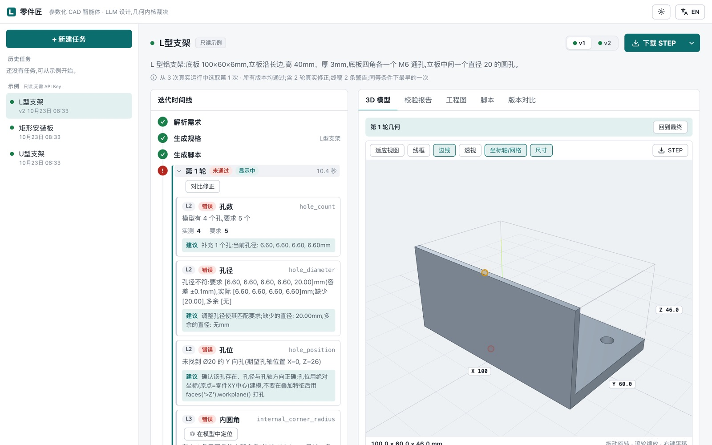
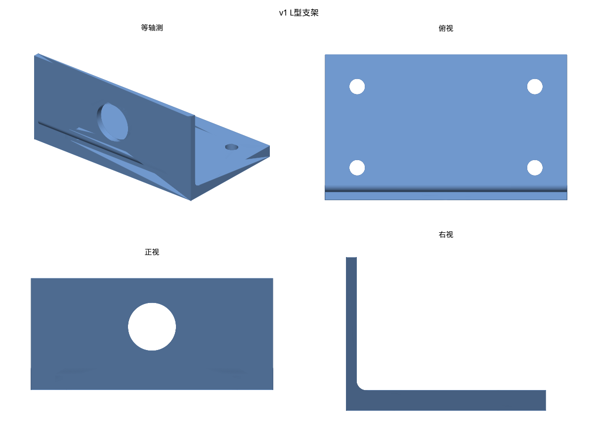
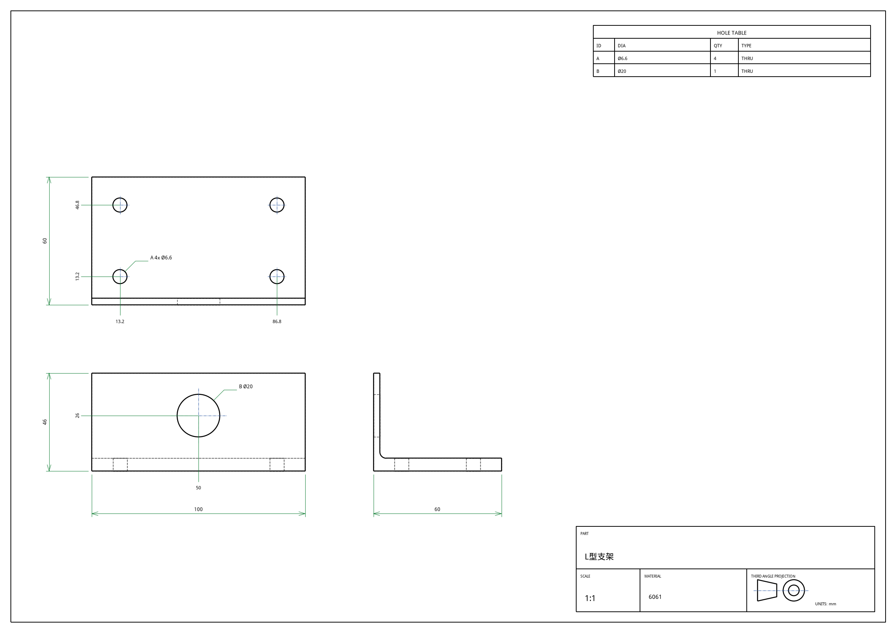

# Lingenious(零件匠)

[English](README.md) | **简体中文**

[](https://github.com/heiworks/lingenious/actions/workflows/tests.yml)

面向 CNC 机加工的参数化 CAD 智能体:输入零件需求,LLM 生成 CadQuery 参数化脚本,**用 OCCT 的 B-Rep 几何做判断**(几何有效性、需求符合度、可制造性规则),不通过则带着具体违规项自动修正,输出 STEP、参数化脚本、渲染图和迭代日志。

> 设计原则:LLM 负责设计,几何内核负责判断。判断是确定性代码,结果可复现、可评测。

状态:v0.1,早期版本。MIT 许可。测试在 Docker 里运行(见下文)。



*Web 界面,L 型支架示例第 1 轮:缺少的 Ø20 孔和内凹尖角由几何检查查出,并标在模型上。*

## 流程

```
需求文本 → 规格解析(LLM, JSON+pydantic) → 生成 CadQuery 脚本(LLM)
        → 沙箱执行 → L1 几何有效 / L2 需求符合 / L3 DFM 规则(确定性代码)
        → 有 error:违规项(带数值与建议)回传 LLM 修正,最多 4 轮
        → 通过:STEP + part.py + render.png + 三视图工程图(DXF/PDF/PNG)+ run.json + log.txt
        → 追问修改("立板厚度改成 4mm")→ 更新规格,基于上一版脚本改参数并重新校验
```

示例迭代日志(真实输出):

```
第1轮:未通过 [hole_count] 模型有 4 个孔,要求 5 个 [hole_diameter] ... 缺少 [20.00] [hole_position] 未找到 Ø20 的 Y 向孔(期望孔轴位置 X=0, Z=26) [internal_corner_radius] 存在 1 条无圆角的内凹尖角(共长 100.0mm ...),圆角半径 0mm,要求不小于 0.5mm(建议 ≥3mm)
第2轮:未通过 [hole_count] 模型有 4 个孔,要求 5 个 [hole_diameter] ... [hole_position] ...
第3轮:通过
```

## 运行(Docker)

任何装了 Docker 的机器都能跑:

```bash
git clone https://github.com/heiworks/lingenious && cd lingenious
cp .env.example .env            # 填入 DEEPSEEK_API_KEY
scripts/run.sh bracket "L 型铝支架:底板 100×60×6mm,立板沿长边,高 40mm、厚 3mm,底板四角各一个 M6 通孔,立板中间一个直径 20 的圆孔。" \
    --material 6061 --modify "立板厚度改成 4mm"
# 构建镜像 lingenious:dev,在容器里运行 CLI,结果复制回 ./out/bracket/{v1,v2}/
```

- LLM 供应商在 `config.yaml` 的 `llm.base_url / model / api_key_env` 配置,任何 OpenAI 兼容接口均可(默认 DeepSeek)。全部配置项、环境变量与 `LINGENIOUS__段__键=值` 覆盖见 [docs/configuration.md](docs/configuration.md)。
- 网络慢时:设置 `APT_MIRROR`(apt 源主机名)和/或 `PIP_INDEX_URL`(pip 源地址),构建镜像时会使用这些软件源。
- 测试:`make test`(构建 `dev` 镜像目标并在其中运行 pytest);`make cov` 查看覆盖率,`make lint` 运行 ruff + mypy;`make help` 列出全部目标(lint、前端检查、评测等)。
- Web 应用:见下方 [Web 应用](#web-应用)。
- 参与开发见 [CONTRIBUTING.md](CONTRIBUTING.md)。


## Web 应用

在同一个智能体之上的浏览器界面:描述零件,实时看每一轮迭代,3D 旋转查看结果,在模型上看到每条违规的位置,查看 DFM 报告和工程图,提出修改生成新版本、对比版本,下载 STEP、工程图、脚本(或打包成 ZIP)。

```bash
cp .env.example .env          # 填入 DEEPSEEK_API_KEY(不填只能看内置示例)
docker compose up --build     # 或:make web
```

打开 **http://localhost:8000**。左侧"示例"里的三个内置示例不需要 API key。

**在线演示:** 同一套界面的只读版本(内置三个示例)部署在 GitHub Pages:https://heiworks.github.io/lingenious/demo/ (没有后端,新建任务需要自己部署)。

- **默认只能本机访问。** 端口只绑定 `127.0.0.1`。要从其他机器访问,请放在带 HTTPS 的反向代理后面,并在 `.env` 里设置 `LINGENIOUS_ACCESS_TOKEN`,界面会要求输入令牌(见 [SECURITY.md](SECURITY.md))。
- **数据:** 运行记录保存在 compose 卷 `data` 里(`docker volume ls` 显示为 `<项目名>_data`,例如 `lingenious_data`;容器内 `/app/data`)。
- **前端开发**(需要 Node 22):`make ui-install`,然后 `cd web/ui && npm run dev`,打开 Vite 打印的地址;`/api` 会代理到 http://localhost:8000(可用 `API_TARGET` 改)。地址后加 `?mock=1` 可以不连后端、用录制的数据运行界面。
- 接口和数据目录:[docs/web-app.md](docs/web-app.md);配置:[docs/configuration.md](docs/configuration.md)。

`web/landing/` 是项目介绍页(静态,用于 GitHub Pages),可用 `make landing-serve` 在 http://localhost:8080 预览。

## 示例

`examples/bracket/` 是上面命令的真实运行结果(L 型支架,6061;图为 v1,v2 为"立板厚度改成 4mm")。`examples/plate/` 与 `examples/u_bracket/` 也是真实运行。全部由 `scripts/make_examples.py` 生成(每个需求跑 3 次,原样发布其中一次;`meta.json` 记录选了哪次、为什么):

| 渲染图 | 工程图 |
|---|---|
|  |  |

## 工程图

`core/drawing` 用 OCCT HLR 生成第三角投影三视图(A3):实线可见边、虚线隐藏边,外形尺寸(取精确包围,不含公差膨胀)、孔径与孔位(从 B-Rep 取,不是 LLM 编的)、孔表、标题栏;DXF 与 PDF 由同一份图元生成。尺寸文字与引线有确定性的避让布局;沉孔标注为 `Ø9 ⌴ Ø15 ↧6`,腰形槽标注长×宽;含沉孔或盲孔的零件自动加一个 A-A 剖视(带剖面线)。样例见 `examples/bracket/v1/drawing.png`。

近似与缺失:锥形沉孔、凹槽剖视、沿 Y 方向孔的剖视、斜向孔的专门视图都没做(斜向孔只进孔表并加注释);无公差标注。HLR 失败时降级为全部按可见边输出。

## 校验

L2 断言(包围盒、孔数、孔径)由 LLM 从需求推导,可能推错(评测里 `m2` 就把 U 型支架的包围盒 Y 向算成了 58 而不是 50)。因此修正阶段会把用户原始需求一并给 LLM,允许脚本用 `# ASSERTION_DISPUTE: <规则名>` 申诉 L2 断言:被申诉的违规降级为 warning,并在日志中标注"脚本申诉"。L1 与 L3 不允许申诉。这避免了"为迎合错误断言改坏尺寸",代价是申诉本身依赖 LLM 判断,所以会留痕。

| 层 | 规则 |
|---|---|
| L0 | 脚本语法/执行错误 |
| L1 | 实体有效、单一实体、体积为正 |
| L2 | 包围盒、孔数、孔径、孔位(以零件包围盒为参考系,平移不影响)、体积范围,以及孔是否被切穿板边 |
| L3 | 孔边距(大孔设上限)、内凹尖角/过小圆角、最小壁厚(近似)、孔间距、孔深径比、深腔、薄筋高厚比 |

规则、阈值见 [docs/dfm-rules.md](docs/dfm-rules.md) 与 `config.yaml`;给工艺人员的复核清单见 [docs/dfm-review-checklist.md](docs/dfm-review-checklist.md)。**阈值为通用经验值,未经工艺人员确认,可配置**(支持按材料、按工艺覆盖)。

## 评测

两套任务集,标准答案都由**参考实体自动算出**(包围盒、孔数、孔径、体积范围 ±3%),与 LLM 解析出的规格无关;每个参考实体都通过全部校验(有单测)。三个配置:A 只生成不反馈;B 加 L1/L2 反馈;C 再加 L3(DFM)反馈。每题每配置跑 3 次。模型:DeepSeek `deepseek-chat`。方括号为 95% Wilson 区间。

```bash
python -m eval.runner --configs A B C --repeat 3 --workers 5             # 主任务集 → eval/results/
python -m eval.runner --taskset dfm --configs A B C --repeat 3 --workers 5   # DFM 任务集 → eval/results_dfm/
python -m eval.report [eval/results_dfm]                                 # 汇总与图
```

(在开发环境里运行,例如容器内,并提供 API key。每次运行都从头开始,并替换输出目录里的 `results.csv`;中断后加 `--resume` 继续,想保留仓库里已有的结果就用 `--out <目录>`。)

### 主任务集(24 题,任务文本写明了圆角等要求)

| 配置 | 一次通过 | 最终通过 | 平均轮数 | 平均 token |
|---|---|---|---|---|
| A 只生成 | 86% [76–92] | 90% [81–95] | 1.08 | 3681 |
| B 加 L1/L2 反馈 | 89% [80–94] | 94% [87–98] | 1.31 | 4274 |
| C 完整闭环 | 94% [86–98] | 99% [92–100] | 1.27 | 4350 |

按难度的最终通过率(A / B / C):简单 100% / 100% / 100%;中等 85% / 89% / 96%;较难 86% / 95% / 100%。

解读:
- 反馈闭环在这套题上趋势一致:最终通过率 90% → 94% → 99%,平均多约 0.2–0.3 轮、多约 15–18% token。A 与 C 的区间只差一点点重叠,**倾向有效但不能说统计上确证**。
- **一次通过率本不该有差异**(三个配置第一轮生成过程相同),却出现 86% / 89% / 94% 的差距,说明单次采样的噪声本身就有这个量级,最终通过率的差距里也含有噪声。
- C 配置有 2 次运行因异常没有结果(样本 70 而非 72)。
- **此前 `h5`(双层阶梯块)在上一轮评测中 9/9 全部失败**,原因是提示词示例里 `faces(">Z").workplane(centerOption=...)` 的写法在叠加特征后会移动原点,孔位整体偏移。改成"绝对坐标建圆柱再切除"的写法并加入孔位校验后,`h5` 本轮 9/9 通过,**包括没有任何反馈的 A 配置**,所以这个改善来自提示词,不是闭环。
- 本轮与上一轮不能直接比较:期间改过提示词、加了孔位校验和三条 DFM 规则。

### DFM 任务集(12 题,任务文本不提示圆角、边距、壁厚)

这套题专门用来检验 L3 反馈。每题的"字面读法"都违反至少一条 DFM 规则(有单测),标准答案取"最小改动的 DFM 合格读法"。终稿 L3 error 越少越好,最终通过率仍按 L1+L2 对标准答案评分。

| 配置 | 最终通过(对标准答案) | 终稿 L3 error 均值 | 平均轮数 | 平均 token | 申诉次数 |
|---|---|---|---|---|---|
| A 只生成 | 92% [78–97] | 2.36 | 1.00 | 3008 | 0 |
| B 加 L1/L2 反馈 | 92% [78–97] | 2.36 | 1.17 | 3326 | 3 |
| C 完整闭环 | 89% [75–96] | 1.67 | 2.89 | 7702 | 46 |

解读:
- 这套题确实能诱发违规:没有 L3 反馈时,每个零件终稿平均有 2.4 个 DFM error。
- **L3 反馈把终稿 DFM error 降了约 30%(2.36 → 1.67),但没有清零**,约 3 轮后仍有残留。
- **忠实度代价,改进前后对比。** 第一次评测里,L3 反馈让最终通过率从 97%(A)掉到 81%(C):模型为了过 DFM 规则,把壁加厚、挪孔位,偏离了需求。之后我们改了修正提示:回传 L3 违规时,同时带上由需求推出、不得改变的约束(包围盒、孔数、孔径、孔位),并写明"宁可保留 DFM 警告,也不要违背需求"。三种配置全部重跑后,差距从 16 个百分点(97 对 81)缩小到 3 个百分点(92 对 89),申诉从 61 次降到 46 次,DFM 收益保持不变(残留 error 1.69 → 1.67)。上一次的结果保留在 `eval/results_dfm/previous/`。
- 注意:同样的题、同样的模型名,A 在两次评测之间就从 97% 变成了 92%,说明两次运行之间的波动有好几个百分点;区间重叠,这个改进是趋势,不是显著结论。C 剩下的失败是 `d7` 和 `d10`(体积超出范围),其中 `d10` 在 A/B 也会失败。
- 成本:L3 反馈仍要约 2.5 倍 token。
- 升级到 CadQuery 2.8 / OCCT 7.9 后复测(同样的题和模型):最终通过率 A 97% / B 100% / C 97%,终稿 L3 error 2.39 / 2.42 / 1.78。没有退化,变化在上面说的运行间波动范围内。数据在 `eval/results_dfm/cadquery-2.8/`。
- 样本量小(每格 36),区间较宽;任务由作者编写,结果针对该模型。

原始数据:`eval/results/results.csv`、`eval/results_dfm/results.csv`;汇总:各目录下的 `summary.md` 与 `comparison.png`。

## 局限(请如实看待)

- 代码式 CAD:STEP 不含特征历史,可编辑性靠参数化脚本。
- 范围窄:单零件、棱柱类、孔/圆角/筋;无装配、曲面、公差、钣金、注塑。
- 孔位校验依赖 LLM 从需求推导期望位置,推错时靠"申诉"兜底;未写明位置的孔不校验。
- 追问修改后的版本按 LLM 更新过的规格校验;规格更新失败时,该版本只做 L1 与 L3 校验(在 `defaults_used` 中注明)。
- **L3(可制造性)反馈仍可能让零件偏离原始需求**:回传违规时附带需求约束后差距明显缩小(见 DFM 任务集评测),但没有消除。
- DFM 规则是系统自带的经验阈值,衡量的是"遵守这些规则",不等于真实可制造性;壁厚检查只对近平行平面对,是近似。
- 沙箱 = AST 白名单 + 子进程 + 超时与内存上限,**不适合执行不可信代码**,生产需容器级隔离。
- 评测规模小(24 + 12 题,每题 3 次),区间较宽;任务由作者编写,结果针对所用模型。

## 后续扩展

工程图的锥形沉孔、凹槽剖视;钣金/注塑/3D 打印规则;DFM 阈值经工艺人员复核;FreeCAD 原生特征输出。

## 飞书多维表格(可选演示适配器)

`adapters/feishu_bitable/`:一行一个需求,轮询脚本调用智能体,把状态、迭代日志、DFM 报告和附件(渲染图、工程图、STEP、参数化脚本)写回同一行;在"修改要求"列填内容即触发基于上一版的修改(版本号加 1)。

前置条件:本机已安装 `lark-cli`,且你已自行执行 `lark-cli auth login --domain base,drive`。仓库里没有任何应用 ID/密钥;脚本会在**你自己的账号**下新建一个 Base。

```bash
python3 adapters/feishu_bitable/setup_base.py      # 新建 Base 与需求表(幂等)
python3 adapters/feishu_bitable/poll.py --once     # 处理一次;去掉 --once 则持续轮询
```

限制:`lark-cli` 的附件上传只追加不替换,各版本文件以 `v1_`、`v2_` 前缀累积在单元格里。表结构与触发规则见 [adapters/feishu_bitable/README.md](adapters/feishu_bitable/README.md)(英文)。

## 参与与许可

见 [CONTRIBUTING.md](CONTRIBUTING.md)。许可证:MIT([LICENSE](LICENSE))。文档索引见 [docs/](docs/README.md)(架构与设计决策见 [docs/architecture.md](docs/architecture.md) 与 [docs/adr/](docs/adr/README.md),英文);给 AI 编程助手的说明见 [AGENTS.md](AGENTS.md)。本项目在 AI 编程工具(Claude Code)的协助下开发。
