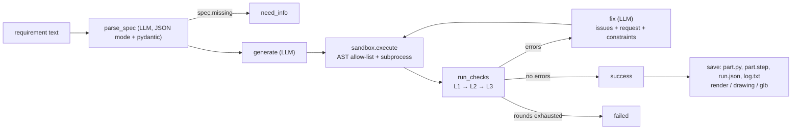

# Architecture

This page describes the system as implemented. Design rationale lives in the [ADRs](adr/README.md); rule
details in [dfm-rules.md](dfm-rules.md) (Chinese).

**Principle:** the LLM designs, the geometry kernel judges. The LLM parses the requirement and writes or
repairs CadQuery scripts. Execution, every pass/fail decision, rendering, drawings and retry control are
deterministic Python ([ADR 0001](adr/0001-llm-designs-kernel-judges.md)).

## Data flow

`core.agent.run()`:

1. `parse_spec` turns the request into a `PartSpec` (`core/models.py`): features, `assertions` (bounding box,
   hole count, diameters, positions, volume range), `defaults_used`, `missing`. One retry with the pydantic
   error on invalid JSON. If `missing` is non-empty the run stops with `need_info`.
2. `generate` asks for a complete CadQuery script that defines `result`.
3. `_loop` runs up to `agent.max_rounds` (default 4) rounds: execute in the sandbox, check, apply
   `ASSERTION_DISPUTE` comments ([ADR 0003](adr/0003-disputable-l2-assertions.md)), stop if there are no
   `error` issues. Otherwise the top 8 issues (errors first) go to the `fix` prompt with the original
   request and, when L3 is active, the spec-derived constraints that must not change
   ([ADR 0004](adr/0004-l3-feedback-with-constraints.md)). The loop also stops early when the script and the
   set of failing rules repeat.
4. Statuses: `success`, `need_info`, `failed`. Warnings never block.

`core.agent.modify()` first asks the LLM to update the previous spec for the change (`update_spec`: changed
feature dims, recomputed bounding box, hole count/diameters/positions; unaffected assertions kept, uncertain
ones dropped, `missing` forced empty). It then sends the previous script plus the change to the LLM and
re-enters the same loop, so a modification is checked against L1, the updated L2 assertions and L3. If the
spec update fails schema validation, the version falls back to no dimension assertions (L1 + L3 only) and
says so in `defaults_used`. Round numbers continue from the previous version.

Execution errors become a single `Issue(level="L0", rule="exec_error")` and go through the same repair path.

## Modules

| Module | Responsibility |
|---|---|
| `core/agent` | The loop above (`run`, `modify`, `save`), eval configs `CONFIG_LEVELS`, dispute handling; `prompts.py` holds all prompt text (Chinese). |
| `core/llm.py` | `LLM`: thin wrapper over the `openai` client for any OpenAI-compatible endpoint (`chat`, `structured`); counts calls and tokens. `extract_code` pulls the first Python block. |
| `core/models.py` | Pydantic contracts: `PartSpec`, `Assertions`, `BBox`, `HolePos`, `Issue` (`rule`, `level` L0-L3, `severity`, `target`, `message`, `measured`, `required`, `hint`, `location`). |
| `core/config.py` | `load_config`: `config.yaml` plus `LINGENIOUS__SECTION__KEY=value` env overrides (see [configuration.md](configuration.md)). |
| `core/sandbox` | `static_check` (imports only `cadquery`, `math`; bans `open`, `exec`, `eval`, `getattr`, dunder attributes, ...), then `runner.py` in a child process with timeout and `RLIMIT_AS`; the child exports `result` to STEP, the parent re-imports it. Not a security boundary (see [SECURITY.md](../SECURITY.md)). |
| `core/checks` | `run_checks(shape, spec, cfg, levels)`. `base.py`: `@rule` decorator, `DEFAULTS`, threshold merging (`dfm_cfg`), `rule_enabled`. `l1.py`: valid / single solid / positive volume. `l2.py`: bbox, hole count, diameter, position, volume range (spec-driven) and `hole_breakout` (always on). `l3.py`: seven DFM rules. `features.py`: shared B-Rep queries (hole detection, convexity, edge distance, breakouts). An exception in an L2/L3 rule is swallowed; L1 errors skip later levels. |
| `core/render` | Software renderer (matplotlib, no GL): `render` (isometric + three orthographic views) and `render_thumb`. |
| `core/drawing` | Third-angle A3 three-view drawing: OCCT HLR projection (`hlr.py`, falls back to all-visible edges), features and sections (`feat.py`), label placement (`layout.py`), DXF via ezdxf and PDF/PNG via matplotlib from the same primitives (`sheet.py`). |
| `core/cli.py`, `core/modify_cli.py` | Command-line entry points; `modify_cli` rebuilds the previous result from `part.py` + `run.json`. |
| `web/server` | FastAPI app (`app.py`): REST + SSE API, optional access token (`auth.py`), file-backed store with per-version `events.jsonl` (`store.py`), thread-pool job runner calling `core.agent` and producing artifacts (`jobs.py`), STEP to GLB tessellation (`meshing.py`). Contract: [web-app.md](web-app.md). |
| `web/ui` | Vite + React + three.js single-page app, built to `web/ui/dist` and served by the backend; `?mock=1` runs on recorded data. |
| `web/landing` | Static project page (GitHub Pages) with a recorded run replay (`data/replay.json`, generated by `scripts/export_landing_data.py`); no backend. |
| `adapters/feishu_bitable` | Optional demo front-end on Feishu Bitable via `lark-cli` ([README](../adapters/feishu_bitable/README.md)). |
| `eval/` | Task sets (`tasks.py`, `tasks_dfm.py`), reference solids (`refs/`, `refs_dfm/`), ground truth derived from them (`build_truth*.py` → `truth*.json`, [ADR 0005](adr/0005-ground-truth-from-reference-solids.md)), resumable runner (`runner.py`, process pool), report with Wilson intervals (`report.py`). |

## Eval configs

`CONFIG_LEVELS` in `core/agent` selects which check levels feed back into the loop:
`A` = none (only L0 execution errors trigger a repair), `B` = L1 + L2, `C` = L1 + L2 + L3 (default
everywhere). The same code path serves the CLI, web app and evaluation; only the levels differ
([ADR 0002](adr/0002-own-agent-loop.md)).

## Outputs

`core.agent.save` writes per version directory (`out/<name>/v<n>/` for the CLI,
`data/runs/<id>/v<n>/` for the web app):

| File | Content |
|---|---|
| `part.py` | Final script (parameters at the top) |
| `part.step` | Final solid, when execution succeeded |
| `run.json` | `status`, `spec`, `rounds[]` (`n`, `seconds`, `code`, `issues`; web adds `glb`), `final_issues`, `usage` (`calls`, `prompt_tokens`, `completion_tokens`) |
| `log.txt` | One line per round (Chinese), e.g. `第1轮:未通过 [rule] message` |

When the final script executed, the CLI adds `render.png` and `drawing.{dxf,pdf,png}`; the web app also
adds `thumb.png`, `part.glb` and per-round `rounds/r<k>.glb`. Artifact failures are reported but never fail
a run. A `need_info` run writes no files from the CLI.

## Extension points

**Adding a rule.** Write a function decorated with `@rule("<id>", "L3")` in `core/checks/l3.py` returning
`list[Issue]` with measured values and a hint; register it in `L3_RULES` in `core/checks/__init__.py`; add
default thresholds to `DEFAULTS` (and optional `RULE_KEYS` aliases) in `core/checks/base.py`; add a
positive and a negative test in `tests/test_dfm_rules.py`; document it in [dfm-rules.md](dfm-rules.md). Rules
must stay deterministic and never call the LLM. Every rule can be disabled with
`dfm.rules.<id>.enabled: false`. See [CONTRIBUTING.md](../CONTRIBUTING.md#adding-a-dfm-rule).

**Adding an LLM provider.** Any OpenAI-compatible endpoint needs only configuration: `llm.base_url`,
`llm.model`, `llm.api_key_env` (the name of the variable holding the key). A provider without an
OpenAI-compatible API needs a class with the same surface as `core.llm.LLM`: `chat(messages, json_mode)`,
`structured(messages, model)` and a `usage` dict. The web app creates clients through
`web.server.jobs.make_llm`, which tests replace with a fake.

**Adding an eval task.** See [CONTRIBUTING.md](../CONTRIBUTING.md#adding-an-eval-task).
